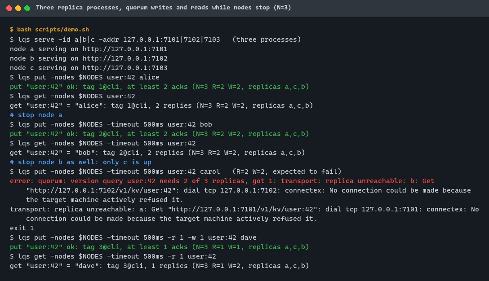
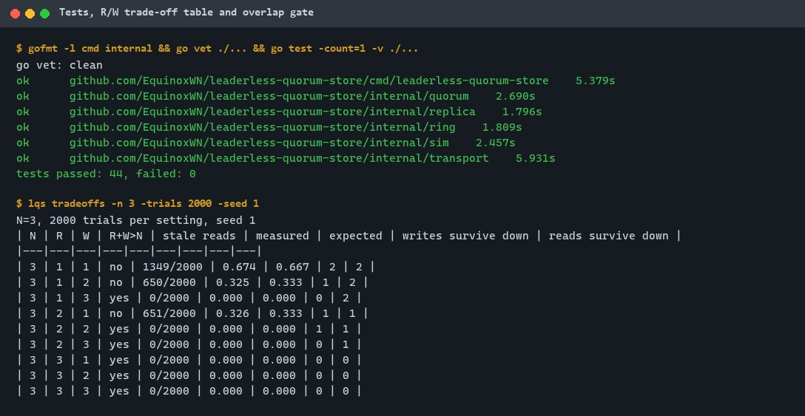
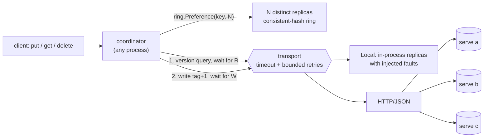
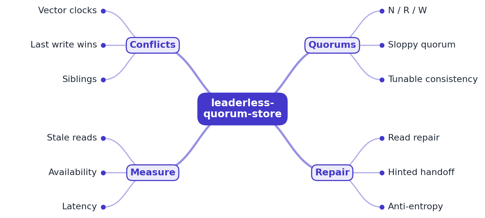

# leaderless-quorum-store

[](https://github.com/EquinoxWN/leaderless-quorum-store/actions/workflows/ci.yml)


> Stay writable even while nodes fail, like Amazon's Dynamo: quorum reads and writes, hinted handoff and repair, with the consistency trade-offs measured.

Part of my **Distributed Systems & Storage** list · Go · core project

## Proof it works

Three replica processes on loopback. With N=3, R=2, W=2 a write still succeeds with one node
stopped and fails with two stopped; with R=1, W=1 it succeeds again on the last node:



44 tests pass, and the trade-off run shows 0 stale reads in every R + W > N setting, with stale
reads close to theory in the others:



## Architecture

**What M1 runs today:**



**Full roadmap (M1 to M3):**



## How it works

_Steps 1 and 2 are built and tested (M1); the rest is on the [roadmap](#roadmap)._

1. Each key is stored on N replicas; a write succeeds after W acknowledgements and a read after R responses.
2. Choosing R + W > N makes read and write sets overlap; lower values trade consistency for availability.
3. When a replica is down, a neighbour keeps a hint and hands the write back later (hinted handoff).
4. Reads compare versions and repair stale replicas on the spot.
5. Merkle trees let replicas find and sync differences in the background without comparing every key.
6. Partition tests measure stale-read rate and availability for different N, R and W settings.

In M1, a key's N replicas are the first N distinct nodes clockwise from its hash on a ring with
virtual nodes. A write first asks the replicas for their newest version tag (waiting for R
replies), then sends the value with a higher tag to all N and returns after W acknowledgements; the
remaining replicas still receive it in the background. A read returns the newest of the first R
replies. Versions come from the replicas, not from clocks ([ADR 0002](docs/adr/0002-versions-from-quorum-query.md)).
Replicas keep data in memory.

## Who it helps

- **Who:** Engineers choosing consistency levels for Cassandra, Riak or another Dynamo-style store, and anyone learning leaderless replication.
- **The problem:** "R + W > N" is easy to quote, but what a given N/R/W costs in stale reads and in how many node failures it survives is rarely shown with running code.
- **How to use it:** Run `tradeoffs` to get the stale-read rate and fault tolerance of every R and W for an N; run three `serve` nodes and use `put`/`get` with different `-r`/`-w` while stopping nodes; read `internal/quorum` for the protocol.

## Tech stack

| Area | In M1 | Planned |
|---|---|---|
| Core | Go standard library, consistent-hash ring with virtual nodes, two-phase quorum writes with version tags, quorum reads | Hinted handoff and sloppy quorum, read repair (M2) |
| Network | HTTP/JSON between coordinator and replica nodes, timeouts and bounded retries | gRPC between nodes |
| Repair | none in M1 | Read repair (M2), Merkle-tree anti-entropy (M3) |
| Test | Unit, exhaustive overlap, randomized fault and concurrency tests, three-process HTTP demo, in-process fault simulation | Network partition tests with charts (M3) |

| Path | What it is |
|---|---|
| `internal/ring` | Consistent-hash ring and preference lists |
| `internal/replica` | Versioned in-memory records, tags, input limits |
| `internal/quorum` | Coordinator: version query, W-ack writes, R-reply reads, retries, quorum errors |
| `internal/transport` | `Transport` interface, in-process transport with fault injection, HTTP client and server handler |
| `internal/sim` | Stale-read and fault-tolerance measurement on the real coordinator |
| `cmd/leaderless-quorum-store` | CLI: `serve`, `put`, `get`, `delete`, `tradeoffs` |
| `scripts/` | `demo.sh` (three processes), `overlap_gate.sh` (CI gate), `vulncheck.sh` |

## Run it

Needs Go 1.23 or newer (CI uses 1.26.10). No third-party modules.

```bash
go test -count=1 ./...                  # 44 tests (CI adds -race)
bash scripts/demo.sh                    # three replica processes on 127.0.0.1:7101-7103
go run ./cmd/leaderless-quorum-store tradeoffs -n 5 -trials 2000 -seed 1
```

`make lint`, `make test`, `make tradeoffs` and `make audit` run the same steps as CI.

By hand, in four terminals:

```bash
go run ./cmd/leaderless-quorum-store serve -id a -addr 127.0.0.1:7101
go run ./cmd/leaderless-quorum-store serve -id b -addr 127.0.0.1:7102
go run ./cmd/leaderless-quorum-store serve -id c -addr 127.0.0.1:7103
NODES=a=http://127.0.0.1:7101,b=http://127.0.0.1:7102,c=http://127.0.0.1:7103
go run ./cmd/leaderless-quorum-store put -nodes $NODES -n 3 -r 2 -w 2 user:42 alice
go run ./cmd/leaderless-quorum-store get -nodes $NODES user:42
```

Flags: `-n`, `-r`, `-w` (default 3, 2, 2), `-id` (coordinator id in version tags, default `cli`),
`-timeout` (per phase, default 2s). `serve` listens on `127.0.0.1:7001` by default and has no
authentication, so keep it on loopback or a private network.

## Tests and results

Latest local run (full detail in [docs/results/m1.md](docs/results/m1.md)):

| Test file | Tests | What it proves |
|---|---|---|
| `internal/quorum/quorum_test.go` | 19 | R-sets and W-sets always meet exactly when R + W > N (exhaustive, N=1..7); each key on exactly N of 6 nodes; W acks and R replies required, fail-fast; stale read with R=W=1; no stale read in 1,800 randomized fault rounds with R + W > N; later write from another coordinator wins; no waiting on slow replicas; timeouts, retries, cancellation; concurrent clients converge |
| `internal/replica/replica_test.go` | 5 | Newest tag wins, repeats are no-ops, invalid records rejected, concurrent writers converge |
| `internal/ring/ring_test.go` | 6 | Distinct, order-independent preference lists; even spread; adding a node moves about 1/9 of keys |
| `internal/transport/transport_test.go` | 6 | Injected faults; HTTP round trip; bad requests get 400; failures classified as retryable or permanent |
| `internal/sim/sim_test.go` | 4 | Measured stale rate matches C(N-W,R)/C(N,R); fault tolerance is N - max(R,W) for writes, N - R for reads |
| `cmd/leaderless-quorum-store/main_test.go` | 4 | End to end over real HTTP servers with nodes failing; 17 bad argument sets rejected; `serve` shuts down cleanly |

| Check | Result |
|---|---|
| Tests | 44 passed, 0 failed (`go test -count=1 ./...`, Go 1.26.10) |
| Stale reads, R + W > N (21 settings at N=3 and N=5) | 0 in 2,000 trials each |
| Stale reads, N=3 R=1 W=1 | 1349/2000 (0.674; theory 0.667) |
| Stale reads, N=5 R=2 W=2 | 613/2000 (0.306; theory 0.300) |
| Nodes down that writes / reads survive, N=5 R=3 W=3 | 2 / 2 |
| Mutation check | 17 of 17 hand mutations killed |
| govulncheck v1.8.0 | GO-2026-6859 in the Go 1.26.10 standard library (fixed in 1.26.11; clean with 1.26.11) |

Stale reads are measured with in-process faults (lost writes, down nodes), not network partitions.
The race detector and all CI steps have not run yet. The 10 quality rules and the mutation check
are recorded in [docs/quality/2026-11-01.md](docs/quality/2026-11-01.md).

## Roadmap

**M1** (≈15 h)
- [x] Write `docs/rfc/0001-design.md`: problem, goals, non-goals, chosen design
- [x] Each key is stored on N replicas; a write succeeds after W acknowledgements and a read after R responses.
- [x] Choosing R + W > N makes read and write sets overlap; lower values trade consistency for availability.

**M2** (≈20 h)
- [ ] When a replica is down, a neighbour keeps a hint and hands the write back later (hinted handoff).
- [ ] Reads compare versions and repair stale replicas on the spot.

**M3** (≈25 h)
- [ ] Merkle trees let replicas find and sync differences in the background without comparing every key.
- [ ] Partition tests measure stale-read rate and availability for different N, R and W settings.
- [ ] Publish the proof below with real numbers

## Proof

What this repo must show before it counts as done:

- Stale-read rate and availability charts for several N/R/W settings under partitions.

| Result | Value |
|---|---|
| M3 charts under network partitions | Not measured yet (M3). Current M1 numbers with in-process faults: see [Tests and results](#tests-and-results). |

## Why it matters

- **Interview angle:** 'Design a highly available key-value store' and consistency trade-off questions.
- **Upstream I'd like to contribute to:** Apache Cassandra documentation or tests.

## Design docs

- [RFC 0001: design](docs/rfc/0001-design.md)
- [ADR 0001: record architecture decisions](docs/adr/0001-record-architecture-decisions.md)
- [ADR 0002: version tags from a quorum query, not from wall clocks](docs/adr/0002-versions-from-quorum-query.md)
- [M1 results](docs/results/m1.md)

## Scope

This is a learning and portfolio system, not a hosted production service. Everything runs
locally. Known limits in M1: data is in memory only; concurrent writes with the same counter are
resolved by coordinator id, so one is lost silently; a write that fails its quorum may still
appear later on the replicas it reached; nodes do not authenticate each other.

## Security and contributing

- Every GitHub Action is pinned to a commit SHA; workflows run read-only, without persisted credentials.
- Dependabot update pull requests are paused (`open-pull-requests-limit: 0`) so the repository keeps a single `main` branch; dependencies are updated by hand and checked by the CI audit.
- `gofmt`, `go vet` and the race detector on every push; `govulncheck` (`make audit`) in CI.
- Report vulnerabilities privately: see [SECURITY.md](SECURITY.md). To contribute, see [CONTRIBUTING.md](CONTRIBUTING.md).

## License

MIT, see [LICENSE](LICENSE).
